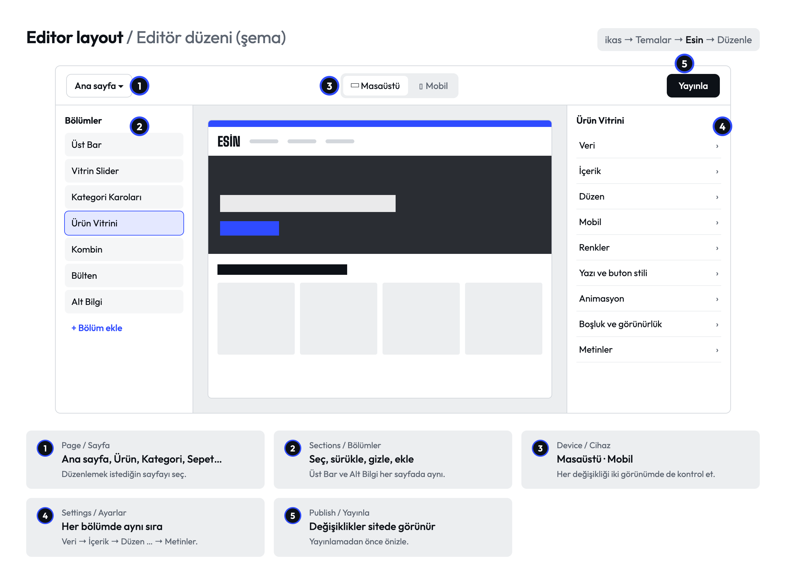
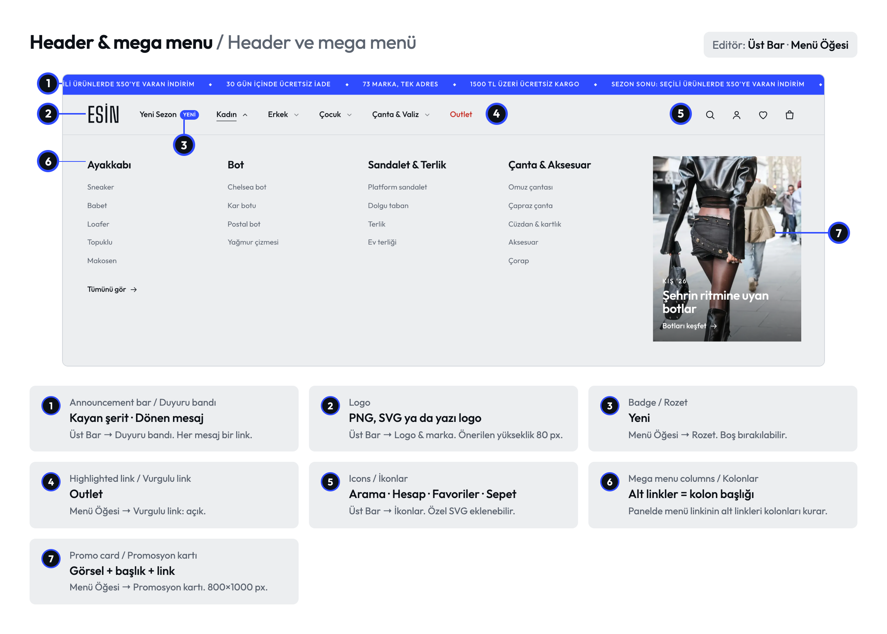
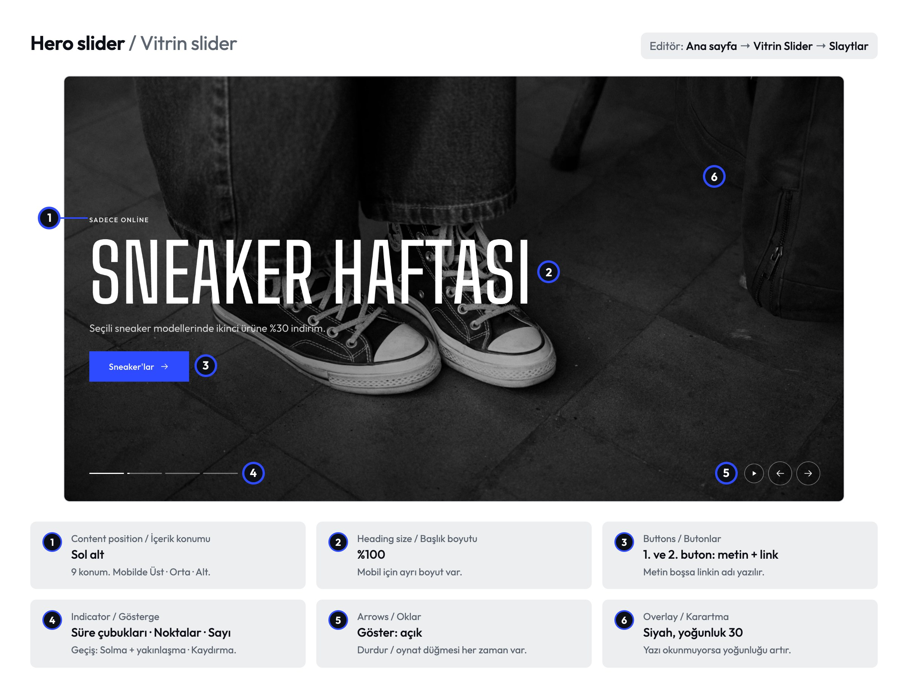
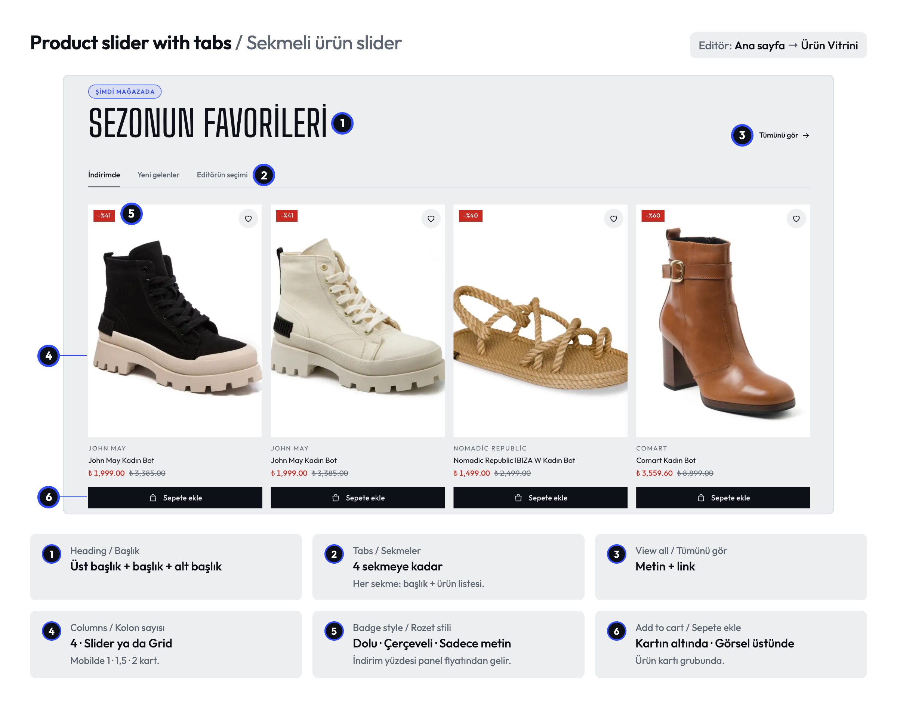
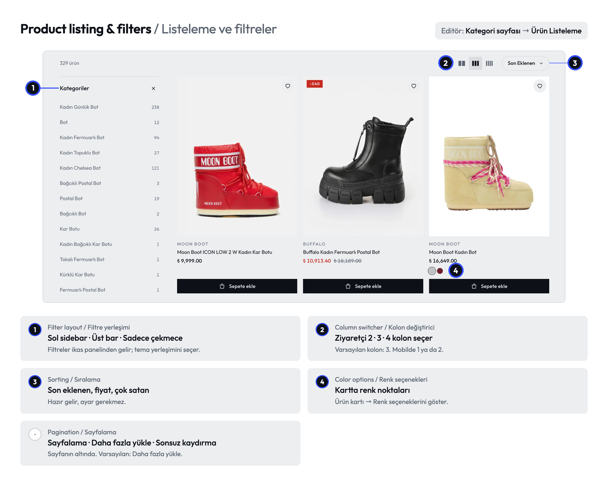
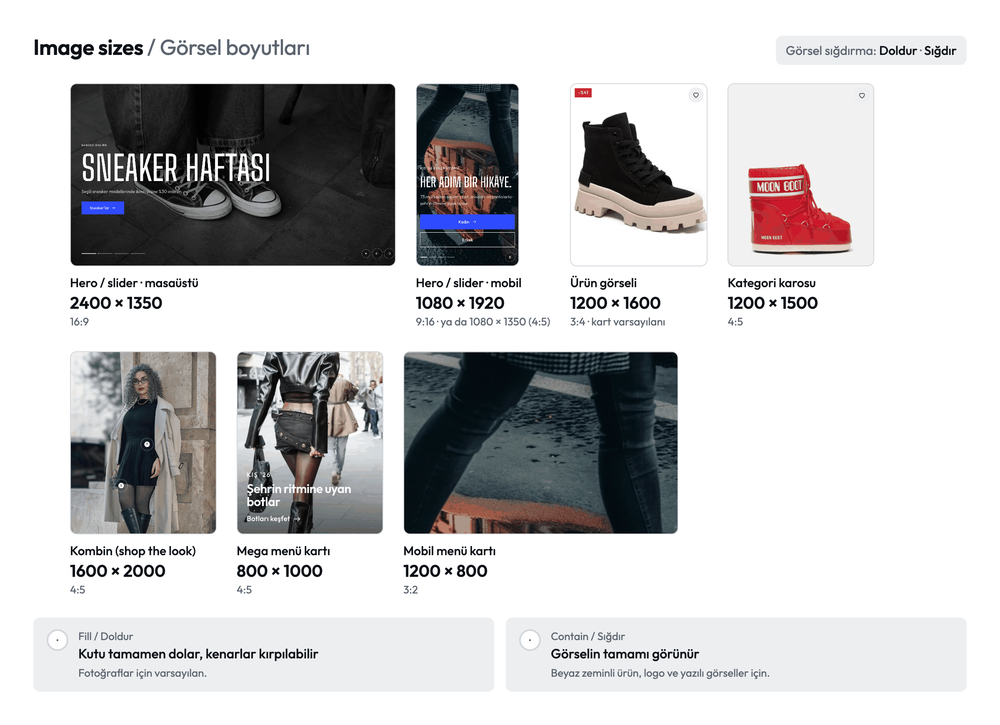

# Esin — ikas Studio teması · Kullanım kılavuzu

Giyim, ayakkabı, çanta ve aksesuar mağazaları için ikas Studio teması. Her bölümde önce görsel, altında kısa adımlar var.
*An ikas Studio theme for apparel, footwear, bag and accessory stores. Each part starts with a picture, then short steps.*

**Canlı önizleme / Live preview:** https://qxwqy-themes.myikas.com/

[Başlarken](#0-başlarken--getting-started) · [Beden tablosu](#1-beden-tablosu--size-guide) · [Ürün kartı](#2-ürün-kartı--product-card) · [Panel → site](#3-panel--site--admin-panel--storefront) · [Kombin](#4-kombin--shop-the-look) · [Yan sepet](#5-yan-sepet--cart-drawer) · [Header](#6-header-ve-mega-menü--header-and-mega-menu) · [Ana sayfa](#7-ana-sayfa--homepage) · [Listeleme](#8-listeleme-ve-filtreler--listing-and-filters) · [Stiller](#9-hazır-stiller--style-presets) · [Mobil](#10-mobil--mobile) · [Görsel boyutları](#11-görsel-boyutları--image-sizes) · [SSS](#12-sık-sorulanlar--faq)

---

## 0. Başlarken · Getting started

1. Panelde tema listesinden **Esin → Düzenle**.
2. Soldan bölümü seç, sağda ayarları değiştir.
3. Üstten **Mobil** görünüme geçip kontrol et, sonra **Yayınla**.

> Her bölümde ayarlar aynı sırada: Veri → İçerik → Düzen → Mobil → Renkler → Yazı ve buton stili → Animasyon → Boşluk ve görünürlük → Metinler. Sitedeki tüm yazılar **Metinler** grubundan değişir.
> *Same settings order in every section. All visible texts are under "Texts".*

---

## 1. Beden tablosu · Size guide

Bağlantı her ürüne uyan tabloyu kendisi seçer. Bedeni olmayan üründe görünmez.
*The link picks the right table for each product and hides on products without sizes.*

### Editörde tablo ekle · Add a table in the editor

1. **Ürün sayfası → Ürün Detay → Beden tablosu → Beden tabloları → +**
2. **Tablo adı:** Kadın ayakkabı
3. **Bedenler:** aralarına boşluk koy → `36 37 38 39 40 41` ya da `S M L XL`
4. **Ölçü satırları:** her ölçü bir satır (Ayak uzunluğu, UK, US). Değerler bedenlerle aynı sırada → `22,5 23 23,5 24,5 25 25,5`
5. **Hangi ürünlerde açılır → Kategoriler:** Kadın → Ayakkabı

### Ürüne özel tablo · Product-specific table

1. Panel: **Ürünler → Tanımlamalar → Özel Alanlar →** yeni alan (tablo, görsel ya da HTML), ürünün içinde doldur.
2. Editör: **Ürün Detay → Beden tablosu → Ürüne özel tablo (özel alan)** → bu alanı seç.

Özel alanı dolu üründe yalnız o tablo görünür.
*A filled custom field overrides the theme tables for that product.*

### Sitede · On the site

Seçili beden vurgulanır · cm / inç · "Nasıl ölçülür?" sekmesi · telefonda alttan açılır.

| Sorun | Çözüm |
|---|---|
| Bağlantı görünmüyor | Tabloya kategori ekle ya da kategorisiz genel bir tablo bırak |
| Seçili beden vurgulanmıyor | Bedenleri ürünlerdeki adla aynı yaz (38 ≠ 38 EU) |
| Değerler kayık | Her bedene tam bir değer yaz |
| Çantada açılıyor | "Yalnız bedeni uyan ürünlerde aç" ayarını aç |
| UK / US satırı inçe çevriliyor | O satırda "Değerler santimetre" ayarını kapat |

---

## 2. Ürün kartı · Product card

**Nerede:** ürün listeleyen her bölümde → **Ürün kartı** (Ürün Vitrini, Ürün Listeleme, Favorilerim…). Her bölüm kendi ayarını taşır.

- **Görsel oranı:** 1:1 · 3:4 · 4:5 · 2:3
- **Hover efekti:** İkinci görsel · Yakınlaştırma · Yok (ikinci görsel için üründe en az 2 görsel)
- **Üzerine gelince beden seçenekleri:** bedenler hover'da çıkar, tek tıkla sepete eklenir
- **Badge'ler:** Tükendi → İndirim % → Yeni → Son X adet

---

## 3. Panel → site · Admin panel → storefront

| Panelde | Sitede |
|---|---|
| İndirimli fiyat | Kırmızı fiyat, üstü çizili eski fiyat, "-%X" badge'i |
| Varyant renk kodu (Tanımlamalar → Varyant Türleri → Renk) | Renk noktası |
| Stok | "Son X adet", 0'da "Tükendi" ve pasif beden |
| Etiket "yeni" ya da "new" | "Yeni" badge'i |
| Marka | Kartta ve ürün sayfasında marka adı |
| Özel alan | O ürünün beden tablosu |

---

## 4. Kombin · Shop the look

1. **Ana sayfa → Kombin (Shop the Look) → Görsel** ekle (1600 × 2000).
2. **Kombin ürünleri:** fotoğraftaki ürünler. Toplam fiyat ve "Tüm kombini sepete ekle" buradan hesaplanır.
3. **Ürün noktaları → +** → ürün seç, **Yatay / Dikey konum** yüzde gir (0/0 sol üst, 100/100 sağ alt).
4. Mobil görsel farklı kadrajdaysa **Mobilde farklı konum**u aç.

---

## 5. Yan sepet · Cart drawer

**Nerede:** Üst Bar → Sepet.

- **Ücretsiz kargo eşiği** paneldeki kargo kuralıyla aynı tutar olmalı. 0 yazarsan çubuk gizlenir.
- **Kasa önü ürünleri** boşsa önerilerdeki en ucuz tek varyantlı ürünler kullanılır.

---

## 6. Header ve mega menü · Header and mega menu

- Menü linkinin **alt linkleri** mega menüde kolon olur; onların alt linkleri kolonun içeriği.
- **Logo (koyu zemin için)** şeffaf header'da kullanılır. **Yapışkan header** ve **Aşağı kaydırınca gizle** Üst Bar → Düzen'de.
- **Arama:** Üst Bar → Arama → ürün listesini "Arama" türünde seç; anlık sonuçlar buradan gelir.

---

## 7. Ana sayfa · Homepage

**Vitrin Slider → Slaytlar → +** ile slayt ekle. Her slayt: görsel (masaüstü + mobil), başlık, 2 buton. Tek görsel istiyorsan **Vitrin (Hero)** bölümünü kullan.

**Ürün Vitrini:** her sekmeye başlık + ürün listesi seç. Yerleşim Slider ya da Grid.

> Sayfada yalnız bir bölümde "Sayfa başlığı (H1)" açık olmalı.

---

## 8. Listeleme ve filtreler · Listing and filters

Filtreler ikas panelindeki filtre ayarlarından gelir; tema yerleşimini ve görünümünü belirler. Telefonda filtre ve sıralama sticky bir çubuktan alttan açılır.

---

## 9. Hazır stiller · Style presets

- Her bölümde **Yazı ve buton stili → Tema havası:** Varsayılan · Editorial · Minimal Lüks · Street / Bold. Fontu, köşeleri, butonu ve başlık harflerini birlikte değiştirir.
- Tüm site için: **Üst Bar → Tema geneli** → köşeler, buton stili, animasyon seviyesi (Kapalı · Hafif · Yoğun).
- "Temaya göre" yazan ayar genel ayarı izler; yalnız farklı olmasını istediğin bölümde değiştir.

---

## 10. Mobil · Mobile

- **Alt navigasyon:** Üst Bar → Tema geneli → Mobil alt navigasyon
- **Sticky sepete ekle:** Ürün Detay → Mobil → Mobilde alttan sabit sepet çubuğu
- **Ayrı mobil görsel:** hero, slider ve kombinde "Görsel (mobil)"; boşsa masaüstü görseli kullanılır
- **Bir bölümü telefonda gizle:** Boşluk ve görünürlük → Görünürlük → Sadece masaüstü

---

## 11. Görsel boyutları · Image sizes

Görselin kesilmesini istemiyorsan o bölümde **Görsel sığdırma → Sığdır** seç.
*Pick "Contain" to show the whole image.*

---

## 12. Sık sorulanlar · FAQ

| Soru | Cevap |
|---|---|
| Renk noktası yerine renk adı yazıyor | Panelde varyant rengine renk kodu gir |
| "Yeni" badge'i görünmüyor | Ürüne "yeni" ya da "new" etiketi ekle (tükenen üründe "Tükendi" görünür) |
| Kartta ikinci görsel açılmıyor | Ürüne 2. görsel ekle ya da Hover efekti "İkinci görsel" olsun |
| Header hero'nun üstünde okunmuyor | Koyu zemin logosu ekle ya da hero karartmasını artır |
| Site yazılarını değiştirmek istiyorum | Her bölümün en altındaki Metinler grubu; ortak yazılar Üst Bar'da |

---

Dokümanlar ve görseller [CC BY 4.0](LICENSE) lisanslıdır. Temanın kaynak kodu bu depoda yer almaz.
*Docs and images are licensed under CC BY 4.0. The theme's source code is not part of this repository.*
