# Esin — ikas Studio theme

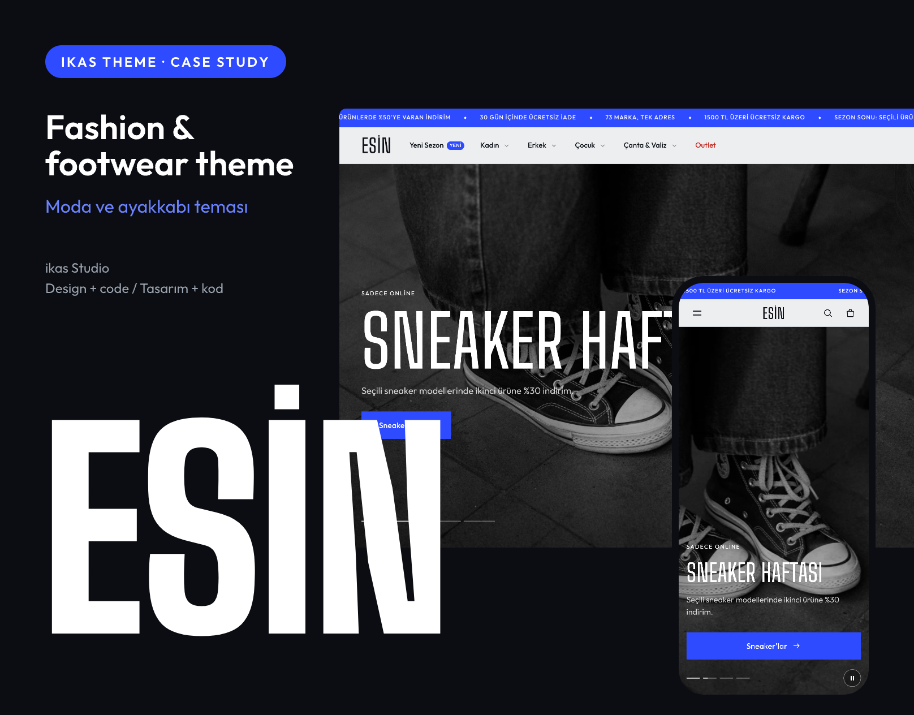

Giyim, ayakkabı, çanta ve aksesuar mağazaları için bir ikas teması. Bu sayfa temanın **öne çıkan kurgularını** görsellerle anlatır: editörde ya da panelde ne yaparsan sitede ne olur.
*A footwear & fashion theme for ikas. This page shows the key setups: what you do in the editor or admin panel, and what happens on the site.*

**Canlı önizleme / Live preview:** https://qxwqy-themes.myikas.com/

---

## 1. Beden tablosu · Size guide

Temanın en önemli özelliği. Ürün sayfasındaki "Beden Tablosu" bağlantısı, ürüne uyan tabloyu kendisi seçer.
*The size guide picks the right table for each product by itself.*

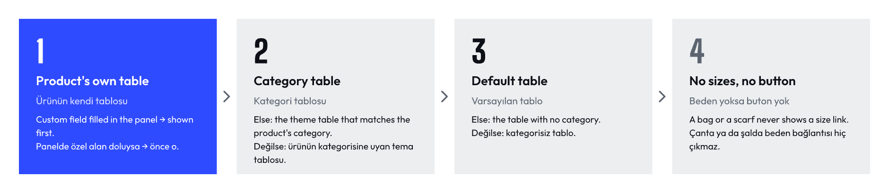

**Editörde kurulum:** Ürün Detay → Beden tabloları → Beden Tablosu ekle → tablo adı, bedenler (`35 36 37 …`), ölçü satırları, ölçüm şeması, kategoriler.

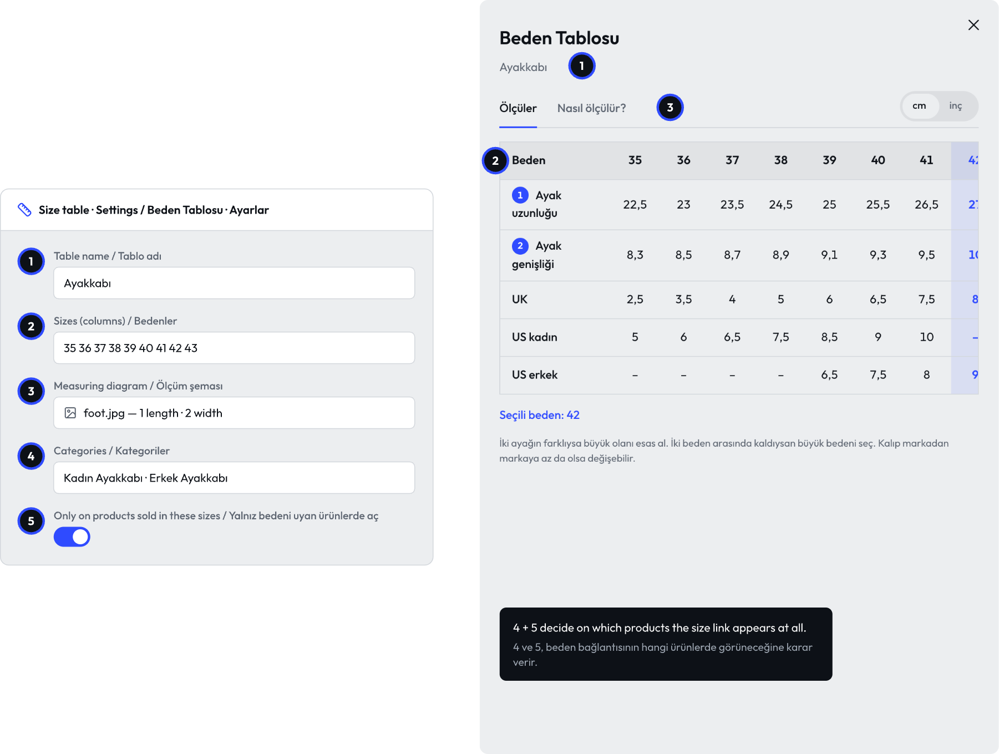

**Panelde ürüne özel tablo:** Özel alan (tablo / görsel / HTML) doluysa her şeyden önce o gösterilir.

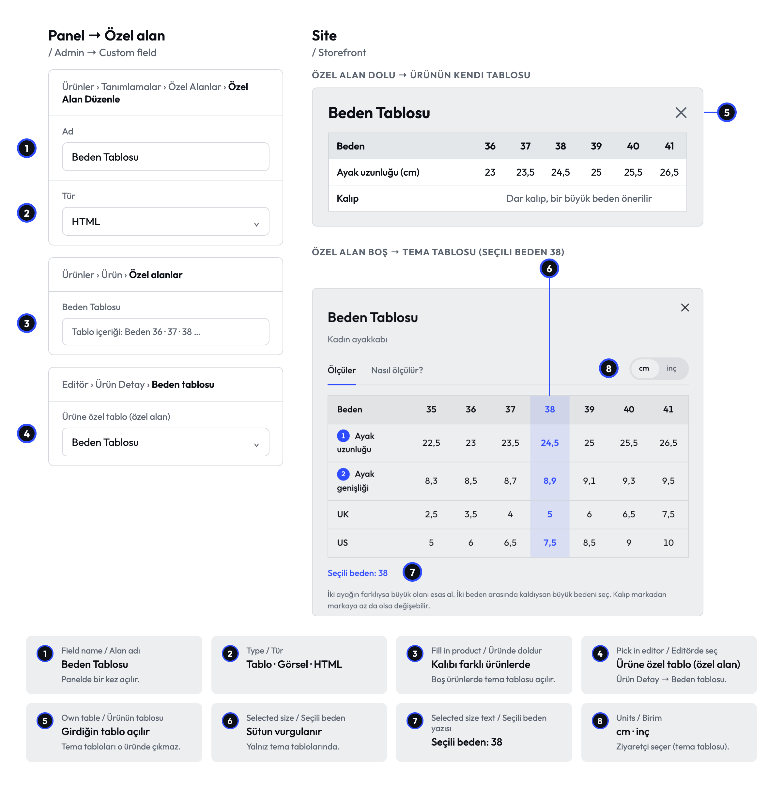

Sitede: seçili beden vurgulu tablo, cm / inç, "Nasıl ölçülür?" sekmesi, mobilde tek beden görünümü.

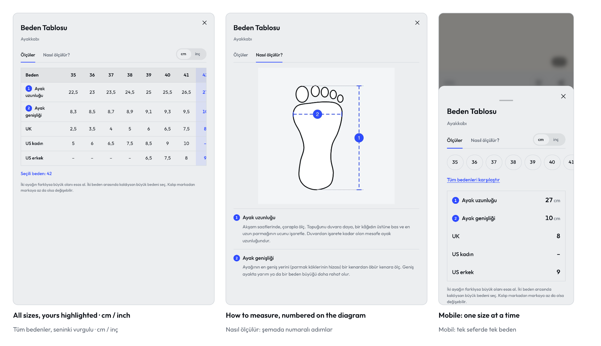

> Bedenleri boşlukla yaz (`36 37 38`), virgül ondalık sayılır. Ürün beden adlarıyla birebir aynı olmalı.

---

## 2. Panel → site · Admin panel → storefront

Ürünü panelde bir kez güncelle, site takip etsin.
*Update the product once in the panel; the site follows.*

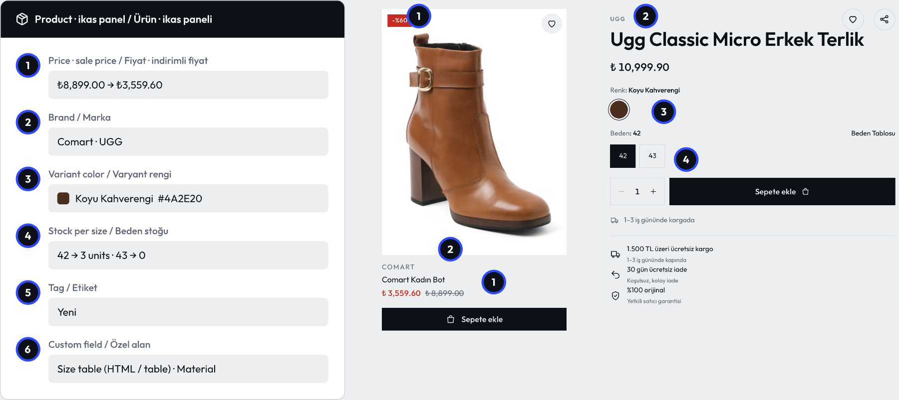

| Panelde | Sitede |
|---|---|
| 1 · İndirimli fiyat | Kırmızı fiyat, üstü çizili eski fiyat, "-%60" rozeti |
| 2 · Marka | Ürün adının üstünde küçük harflerle |
| 3 · Renk kodu | Kart, filtre ve üründe gerçek renk noktası |
| 4 · Stok | Bedenler, "Son 3 adet!", "Gelince haber ver" |
| 5 · "Yeni" etiketi | Kartta "Yeni" rozeti |
| 6 · Özel alan | Ürüne özel beden tablosu, ürün özellikleri |

Renk kodu verilmezse renk noktası gri kalır:

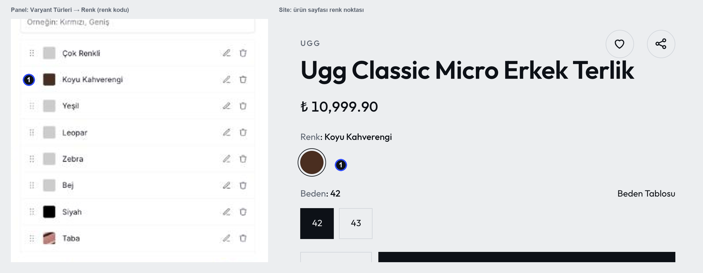

---

## 3. Kombin noktası · Shop the look

Editörde ürünü seç, iki kaydırıcıyla yerleştir: %64 / %88 noktanın fotoğraftaki yeri. "Tüm kombini ekle" tek dokunuş.
*Pick a product, slide it into place. 64 % / 88 % is exactly where the dot sits.*

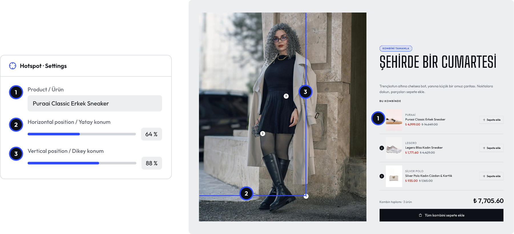

---

## 4. Sepet çekmecesi · Cart drawer

Üst Bar → Sepet: sepet tipi, ücretsiz kargo eşiği, önerilen ürünler, kasa önü ürünleri.
*Free-shipping bar, "add another size", one-tap add-ons.*

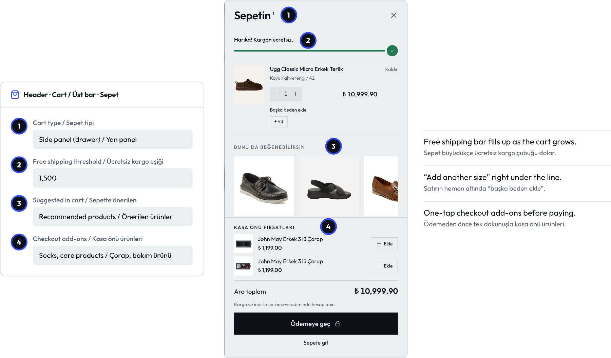

> Ücretsiz kargo eşiği paneldeki kargo kuralıyla aynı tutar olmalı.

---

## 5. Ürün kartı · Product card

Her ürün listeleyen bölümde: görsel oranı, hover efekti, rozet stili, sepete ekle düğmesi.
*Card ratio, hover, badge style and quick add, per section.*

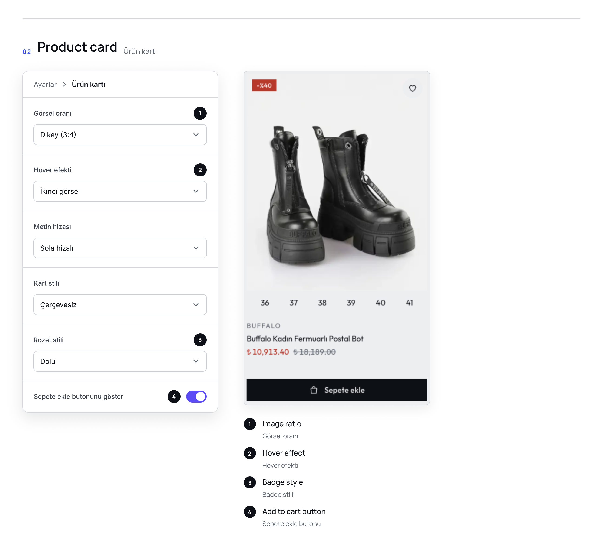

---

## 6. 3 hazır stil · 3 ready styles

Herhangi bir bölüm → Yazı ve buton stili → Tema havası. Seçilen stil başlık fontunu, harf biçimini, köşe yuvarlaklığını ve buton şeklini birlikte değiştirir; tüm mağaza ya da tek bölüm için.
*Each style changes heading font, letter case, corners and button shape together — for the whole store or one section.*

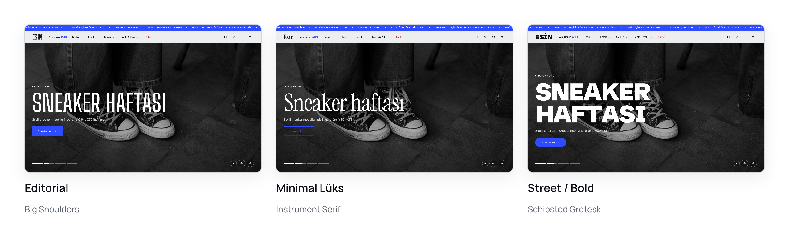

---

## 7. Mobil · Mobile

Alt menü, header ile kayan filtre çubuğu, hep ekranda duran "Sepete ekle", alttan açılan beden tablosu ve sepet.
*Bottom nav, sticky add to cart, size guide and cart as sheets.*

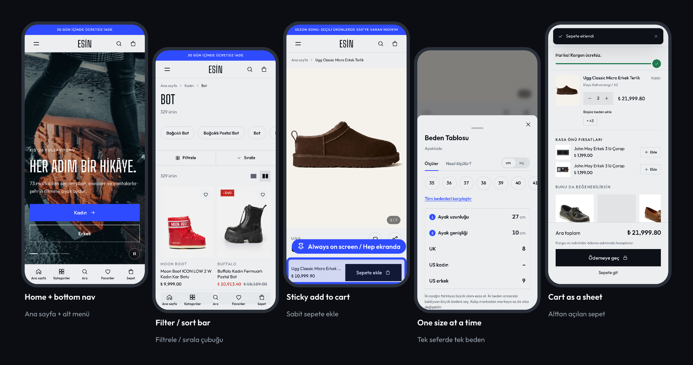

---

Dökümanlar ve görseller [CC BY 4.0](LICENSE). Temanın kaynak kodu bu depoda değildir.
*Docs and images under CC BY 4.0. The theme's source code is not part of this repository.*
